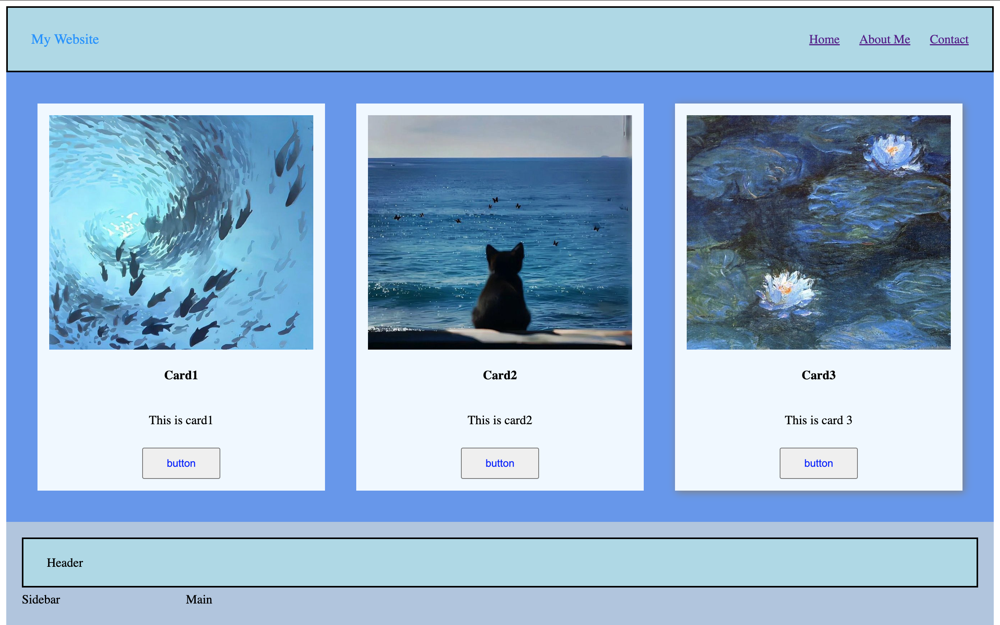
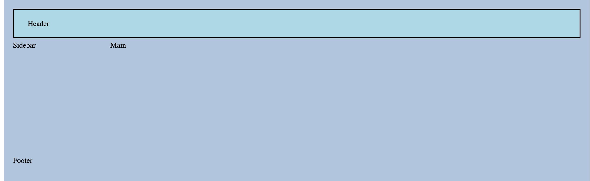
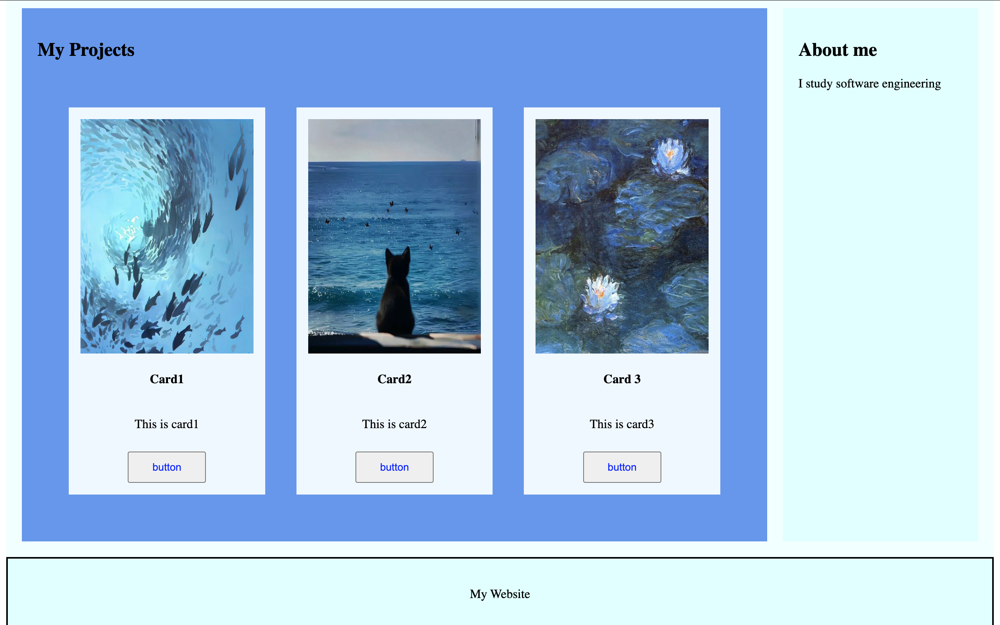

# Assignment #2. Advanced CSS (Flexbox & Grid)

**Name:** Akmarzhan Nurtas  
**Group:** SE-2538 
**Repository:** 

---

## Objective

The goal of this assignment is to understand and apply advanced CSS layout techniques using **Flexbox** and **CSS Grid**. The project demonstrates building complex, responsive layouts without using floats or external frameworks.

---

## Task 1. Card Row (Flexbox)

**Description:**  
A container with three cards, each containing an image, title, text, and a button. The container is a flex container so that cards are displayed in a row, have equal height, consistent gaps, and a hover effect.

**Implemented:**
- `display: flex` on `.container` with `gap: 20px`
- `align-items: stretch` — equal card height
- `flex: 1` on each `.card` — equal width
- `:hover` — box-shadow + lift effect

**Screenshot:**

---

## Task 2. Page Layout with Grid Areas

**Description:**  
A layout with header, sidebar, main content, and footer using CSS Grid and `grid-template-areas`.

**Implemented:**
- `display: grid` on `.layout`
- `grid-template-columns: 200px 1fr`
- `grid-template-rows: 60px 240px 40px`
- `grid-template-areas`:
- Each section assigned to its grid area via `grid-area`

**Screenshot:**

---

## Task 3. Image Gallery (Grid)

**Description:**  
A gallery with nine images displayed in a grid, with consistent gaps and a hover caption overlay.

**Implemented:**
- `display: grid` on `.gallerycontainer`
- `grid-template-columns: repeat(3, 1fr)` — 3 equal columns
- `grid-auto-rows: 250px` — equal row height
- `gap: 10px`
- `:hover` on `.pic` — image zoom + caption overlay (`opacity: 0 → 1`)

**Screenshot:**

---

## Part 3. Combining Flexbox & Grid

**Description:**  
A portfolio page combining both Flexbox and Grid: a flex header navigation, a grid main section (projects + sidebar), flex card content, and a full-width footer.

**Implemented:**
- `.portfolioheader` — `display: flex` for navbar
- `.mainportfolio` — `display: grid; grid-template-columns: 1fr 250px`
- `.card` — `display: flex; flex-direction: column` inside each project
- `.portfolio-footer` — spans full width at the bottom

**Screenshot:**

---

## Technologies Used

- HTML5
- CSS3 (Flexbox, CSS Grid)

---

## Summary of Work Process

For this assignment, I first built the header using **Flexbox** with `justify-content: space-between` to place the logo on the left and navigation links on the right, and `align-items: center` for vertical alignment.

Next, I created the **card row** using a flex container with `align-items: stretch` and `flex: 1` on each card, which ensures all cards have equal height and width. I added a `:hover` effect with `box-shadow` and a slight `translateY` for a lift animation.

For **Task 2**, I used **CSS Grid** with `grid-template-areas` to define a classic page layout: header on top, sidebar left, main content right, footer at the bottom. The key was matching the number of columns in `grid-template-columns` with the number of columns in `grid-template-areas`.

For **Task 3**, I built an **image gallery** using `grid-template-columns: repeat(3, 1fr)` and `grid-auto-rows` for equal row heights. Each image is wrapped in a `.pic` container with `position: relative`, and a `.caption` element with `position: absolute` that appears on hover using an `opacity` transition — creating a dark overlay effect.

Finally, for **Part 3**, I combined both techniques: a Flexbox navbar, a Grid main section with two columns (projects + sidebar), and Flexbox inside each project card for vertical content alignment. The footer spans the full width at the bottom.

Throughout the work, I focused on consistent spacing (`gap`), alignment (`align-items`, `justify-content`), and clean, readable CSS.

---

## Requirements Checklist

- [x] Header with logo (left) + nav links (right)
- [x] Header is a flex container, links spaced with `gap`, vertically centered
- [x] Card row: 3 cards, flex container, equal height, gap, hover effect
- [x] Grid layout with header, sidebar, main, footer via `grid-template-areas`
- [x] Image gallery: 9 images, 3-column grid, gaps, hover caption overlay
- [x] Combined Flexbox + Grid portfolio page
- [x] Footer spans full width
- [x] Consistent spacing and alignment

---

##  References

1. Abitova G.A. Web technologies Front-End Development. Part 1 (2022)
2. https://www.w3schools.com/css/css3_flexbox.asp
3. https://www.w3schools.com/css/css_grid.asp
4. https://www.w3schools.com/css/css3_box-sizing.asp

